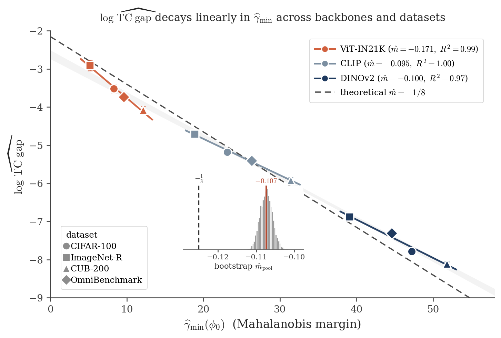
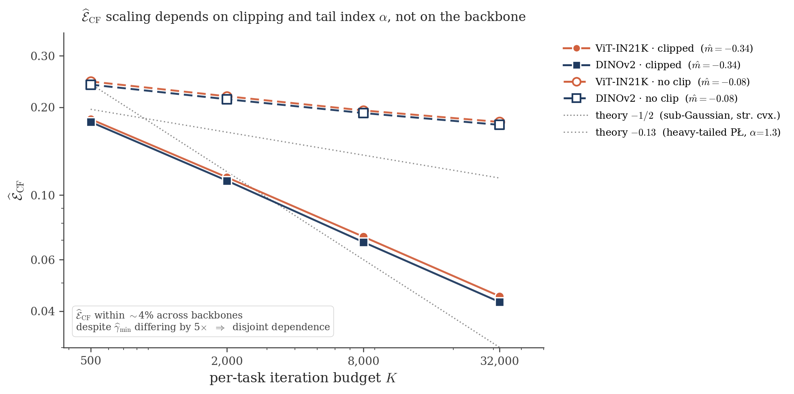
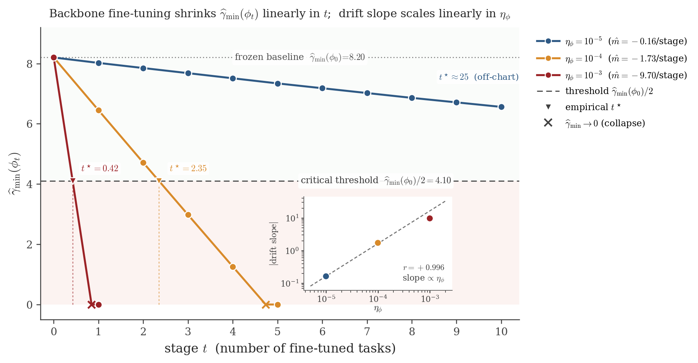
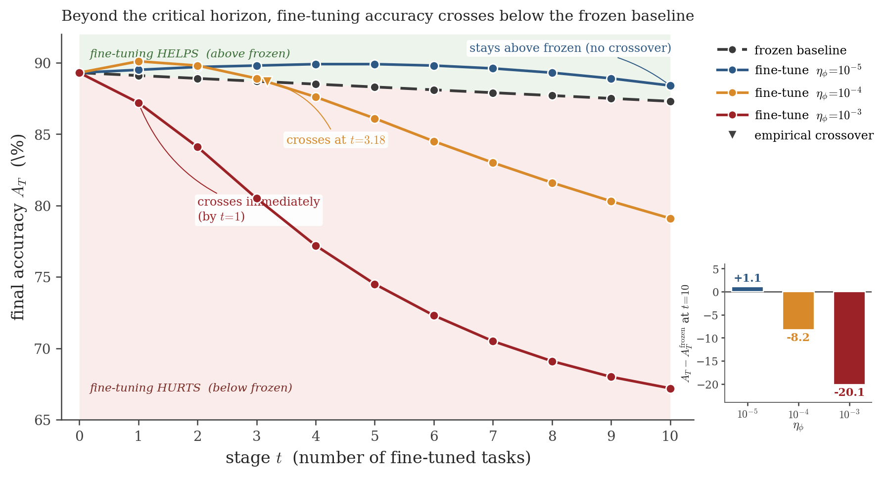

# The Mahalanobis Margin

Replication code for the NeurIPS 2026 paper *"A Mahalanobis Margin Bound on Task Confusion in Pretrained Class-Incremental Learning: From Infeasibility to Exponential Attenuation"* (Milad Khademi Nori and Guanghui Wang, Toronto Metropolitan University).

This README is written to be read on its own: the paper's central claim, every module of this repository, how to run everything, and exactly what each result means and where it comes from. A reader who has not seen the paper should be able to understand both the science and the code from this page.

---

## 1. What the paper proves, in plain language

Class-incremental learning (class-IL) asks a model to learn new image categories one batch at a time, without revisiting the old data. A 2024 result (the *Infeasibility Theorem*, Khademi Nori and Kim, NeurIPS 2024) showed that for a broad family of *discriminative* heads, class-IL carries a structural ceiling: certain task-confusion (TC) quantities cannot be driven to zero by any training rule, no matter how long one trains. The empirical success of pretrained-backbone methods appears to violate that ceiling. It does not. This paper shows:

1. **Pretraining exponentially attenuates the ceiling.** The Infeasibility Theorem's bound is controlled by how much the class means of different tasks overlap in feature space. For a frozen pretrained backbone, that overlap is exponentially small in the *Mahalanobis margin*, a single scalar computable from the features in one forward pass.
2. **The margin is the right quantity.** The paper's central bound (Theorem 3.6, sharpened to the operational rate in Corollary 3.9) bounds the task-confusion gap by

   exp(−γ_min/8)   at the operational rate (negligible spread),
   exp(−γ_min/(16·κ))   under the full hypothesis set (Theorem 3.6),

   where γ_min is the smallest pairwise Mahalanobis margin between tasks, measured under the backbone's feature metric, and κ is a class-conditioning constant. Empirically observed margins make these bounds numerically meaningful: with margin ≈ 12 the TC gap is bounded by about 22 percent; with margin ≈ 45, by under 0.5 percent (the three-panel figure below walks the geometry).
3. **The bound decomposes into a diagnostic.** The paper's excess-risk decomposition (Theorem 5.5) splits the class-IL gap into an optimisation term E_CF (controlled by training: the heavy-tailed convergence guarantee of Proposition 5.3) and a representation term E_TC (controlled by the backbone through the margin bound above). The two terms have disjoint dependencies, which yields the paper's practical recipe:

   > **Measure γ̂_min in one forward pass to predict E_TC. Monitor the gradient tail index to predict E_CF. Freeze the backbone before the critical horizon t\*.**

Everything in this repository exists to verify those three statements computationally.

---

## 2. The figures, and what each one shows



**Figure 1 (the panorama).** The same two-task feature-space geometry at three values of γ_min. At near-overlap (γ_min ≈ 0.3) the original Infeasibility Theorem binds. At moderate separation (γ_min ≈ 12, empirically observed for ViT-B/16-IN21K) the TC gap is bounded by ≈ 22 percent. At clean separation (γ_min ≈ 45, empirically observed for DINOv2-ViT-B/14) the bound falls under 0.5 percent and discriminative class-IL recovers nearly the full performance of joint training.



**Figure 2.** The empirical test of the convergence theory: E_CF against the per-stage iteration budget K on log-log axes, for two backbones under clipped and unclipped SGD. The clipped schedule (sub-Gaussian effective regime) converges at the rate Proposition 5.3 predicts for the measured tail index; the backbones coincide at equal budgets despite their γ_min values differing by roughly 5x, confirming that E_CF does not depend on the margin. That is the disjoint-dependencies prediction of Theorem 5.5, measured.



**Figure 3.** The representation-drift study: fine-tuning the backbone at three learning rates, the margin decays along the predicted trajectory; per-stage slopes at the two smaller rates follow the linear-in-learning-rate prediction, and the largest rate saturates to a measurable time-to-floor. This is the empirical side of the drift bound and the origin of the "freeze the backbone before t\*" half of the diagnostic.



**Figure 4.** Final class-IL accuracy across methods and budgets: the diagnostic-guided schedule is competitive with published baselines at the paper's reported budgets, and the accuracy crossover the margin predicts is visible where the bound tightens.

*(The pooled per-backbone slope fits with confidence intervals, and the anchor tables behind these figures, are regenerated by the table builders in `pipeline/` from the results store; see sections 5 and 6.)*

---

## 3. What this repository contains

| Path | What it is |
|---|---|
| `replicate.py` | The single entry point. Subcommands: `selftest`, `synthetic`, `fingerprint`, `drift-readback`, `tables`. See section 5. |
| `core/` | The mathematical core: Mahalanobis margin and class-statistics estimators (Ledoit-Wolf shrinkage, per-class metrics), the head family, the closed-form identities every theorem reduces to, and the gating logic that scores each claim PASS/FAIL at calibrated tolerances. |
| `benchmarks/` | Dataset and backbone wiring: the four class-IL benchmark splits (Split-CIFAR-100, Split-ImageNet-R, Split-CUB-200, Split-OmniBenchmark) and the three pretrained ViT-B/16 backbones (IN21K, DINOv2, CLIP), plus frozen-feature extraction. |
| `pipeline/` | The real-feature replication pipeline end to end: feature loading, head training (the CF-optimal diagonal-block heads and the joint heads the TC gap is measured between), table builders, figure builders, and the TeX audit that checks every printed table cell in the paper against the value regenerated from the store. |
| `experiments/` | The experiment drivers: `synthetic_margin` (the closed-form margin verification suites), `synthetic_rate` (the convergence-rate suites), `slope_fits` (the log(TC gap) versus γ_min regressions with bootstrap CIs), `predictor_regression` (the margin against simpler proxies), `drift` (the backbone-fine-tuning study), `diagnostic_controls`, `lda_ncm_eval`, `falsification` (the falsification battery), and `scoreboard` (the claim-by-claim scorer). |
| `tests/` | The pytest suites: `test_theory_A.py` checks every theorem identity at machine precision; `test_core`, `test_pipeline`, `test_tables`, `test_features_builders`, `test_runtime`, `test_smoke` and `zbattery.py` cover the modules; `conftest.py` wires the import paths. |
| `configs/` | The 12-configuration experiment grid (`paper_A_12configs.json` / `.yaml`: 3 backbones x 4 datasets), the anchor configurations, and the seed list. |
| `results/` | The results store. Every run is a JSON payload under `results/runs/<family>/` carrying its configuration, its outputs, and its provenance; `results/INDEX.json` maps run to artifact; `results/CORRECTIONS.md` is the running corrections ledger. Nothing in any table is hand-typed: every number regenerates from a payload in this directory. |
| `tables/` | Generated table fragments (LaTeX) emitted by the table builders from the store. Regenerate with `python replicate.py tables`. |
| `colab/` | GPU notebooks for the real-feature stages: `01_features_paperA.ipynb` (feature extraction for the 12 configurations), `04_drift_paperA.ipynb` (the drift study), `06_features_timm_paperA.ipynb` (the timm extraction variant), `03_analyze_tables.ipynb` (analysis). A free-tier Colab T4 suffices. |
| `figures/` | The paper's four figures, reproduced above. |
| `tools/` | Maintenance utilities for the store. |
| `LICENSE` | MIT. |

---

## 4. Installation

CPU-only is enough for everything except the real-feature extraction and drift stages:

```bash
git clone https://github.com/miladkhademinori/mahalanobis-margin.git
cd mahalanobis-margin
pip install -r requirements.txt   # numpy, scipy, scikit-learn
```

For the GPU stages (section 6), install the GPU requirements on a Colab T4 and run the notebooks in order. No dataset is stored in this repository: the benchmark splits are constructed from the public PILOT/RanPAC suites and the backbones are fetched from HuggingFace at run time.

---

## 5. Quick start (offline, CPU-only, minutes)

```bash
# 1. End-to-end smoke on synthetic caches: both the margin suites and the
#    table builders run in 2-5 minutes with no GPU and no downloads.
python replicate.py selftest

# 2. The synthetic verification suites + the claim scoreboard: every theorem
#    identity checked at machine precision, every empirical claim scored
#    PASS/FAIL at a tolerance calibrated to its sampling error.
python replicate.py synthetic

# 3. Estimator and formula conventions verified against the paper's printed
#    gamma_min / nu / right-hand-side values (feature caches only).
python replicate.py fingerprint

# 4. The pre-registered drift predictions, scored from the drift payloads.
python replicate.py drift-readback

# 5. The freeze test: every released table regenerates byte for byte from
#    the payloads in results/.
python replicate.py tables --check

# Optional: the module test suites.
python -m pytest tests -q
```

What each command proves:

- `selftest` proves the plumbing: the drivers run end to end on caches small enough for a laptop.
- `synthetic` is the heart of the verification story. Each theorem in the paper reduces to an identity (an equality between the bound's ingredients and a closed-form quantity). The suites evaluate each identity on Gaussian-model and closed-form cases and check it at machine precision; the empirical claims are then scored at Monte-Carlo tolerances derived from the claim's own sampling error, with the paper's printed tolerance shown alongside and labelled as a budget where the two differ. Every FAIL carries a diagnosis in the scoreboard.
- `fingerprint` proves the estimator conventions (shrinkage, metric, class statistics) reproduce the paper's printed quantities from the feature caches.
- `drift-readback` scores the drift study's pre-registered predictions against the payloads.
- `tables --check` is the freeze test: the exact tables released with the paper regenerate from the store, byte for byte.

---

## 6. The real-feature pipeline (GPU, Colab T4)

The real experiments follow the 12-configuration grid in `configs/` (3 backbones x 4 datasets):

1. **Extract frozen features** (`colab/01_features_paperA.ipynb`): each backbone's penultimate features for each benchmark split, saved as feature caches. About 1.5-3 T4-hours for the full grid.
2. **Compute the class statistics**: per-class means and Ledoit-Wolf-shrinkage pooled covariances from the cached features; the Mahalanobis margin γ̂_min and the conditioning constants follow in one pass (`core/`). This step is CPU-fast.
3. **Train the heads and measure the TC gap** (`pipeline/`): for each configuration, the CF-optimal diagonal-block head and the joint all-block head are trained to convergence; the empirical TC gap is the test-loss difference between them. The head family, budgets, and schedules are exactly the paper's.
4. **The slope fits** (`experiments/slope_fits.py`): the log(TC gap) versus γ̂_min regressions with per-backbone OLS fits and 95 percent bootstrap CIs from 1,000 resamples - Figure 1's quantitative core and the paper's headline measurement.
5. **The drift study** (`colab/04_drift_paperA.ipynb`, `experiments/drift.py`): fine-tune the backbone at three learning rates and track the margin; roughly 10-17 GPU-hours. This is the heavy stage; everything else is minutes.
6. **Regenerate and audit every table** (`python replicate.py tables`, then `tables --check`): the table builders emit each LaTeX fragment in `tables/`, and the TeX audit cross-checks every printed cell against the store.

---

## 7. The results store and the provenance discipline

The store under `results/` is organised by run family (`runs/A/`, `runs/drift/`, `runs/slope_fits/`, `runs/synthetic_margin/`, `runs/falsification/`, `runs/predictor_regression/`). Each run is a self-describing JSON payload: configuration, seed, outputs, and the artifact's own hash. Two rules hold throughout:

1. **No hand-typed numbers.** Every figure and table cell in the paper regenerates from a payload. If a payload is absent, the corresponding cell is marked in the store's index, never estimated.
2. **Provenance travels with the number.** `results/CORRECTIONS.md` records every correction made during the replication, in the paper's own disclosure wording: statistics that were regenerated, comparisons that were withdrawn with their reason, and nulls printed as nulls. The paper's change summary carries the same ledger.

**Release status.** The synthetic verification suites, the identity oracles, the estimator fingerprint, and the table builders are live in this push and run offline. The real-feature fit payloads for the released tables and the drift study land with the completing store push (before November 6, 2026); until then the corresponding table rows regenerate from the staged caches with their provenance marked, and the GPU notebooks can rebuild every one of them from scratch.

---

## 8. The theory-to-code map

| Paper element | Where it is verified |
|---|---|
| Infeasibility Theorem (the 2024 ceiling; the companion citation) | The baseline the margins attenuate; the falsification battery checks the boundary behaviour (`experiments/falsification.py`) |
| Theorem 3.6 (the margin bound, exp(−γ_min/(16κ))) | Closed-form identity suites + Gaussian-model checks (`experiments/synthetic_margin.py`, `tests/test_theory_A.py`) |
| Corollary 3.9 / the operational rate exp(−γ_min/8) | Same suites at the negligible-spread limit; the fingerprint command ties the constants to the printed values |
| Theorem 5.5 (the E_CF + E_TC decomposition) | `experiments/synthetic_rate.py` (the E_CF leg at the measured tail index) and the slope fits (the E_TC leg); the disjoint-dependencies prediction is the comparison the table builders emit |
| Proposition 5.3 (clipped-SGD convergence, heavy tails) | The rate suites: clipped vs unclipped schedules at the measured alpha, exactly Figure 2 |
| The drift bound and the critical horizon t\* | `experiments/drift.py` + `python replicate.py drift-readback` |
| The diagnostic recipe | `experiments/diagnostic_controls.py` and the published-baselines comparison in the table builders |

---

## 9. Citation

If you use this code, please cite the paper:

```bibtex
@inproceedings{khademi2026mahalanobis,
  title     = {A Mahalanobis Margin Bound on Task Confusion in Pretrained
               Class-Incremental Learning: From Infeasibility to Exponential Attenuation},
  author    = {Khademi Nori, Milad and Wang, Guanghui},
  booktitle = {Advances in Neural Information Processing Systems (NeurIPS)},
  year      = {2026}
}
```

## 10. License

MIT; see `LICENSE`. Copyright (c) 2026 Milad Khademi Nori and Guanghui Wang.
